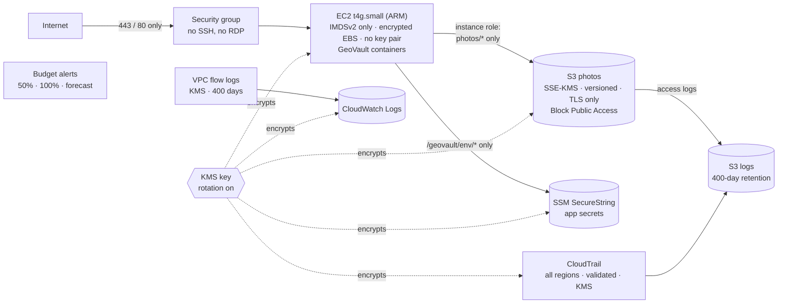

# geovault-infra

Infrastructure as code for [GeoVault](https://github.com/dragonday3/geovault), a security
portfolio app. This is **Project 2: cloud security**: a hardened, low-cost AWS deployment in
**ap-south-1 (Mumbai)**, written in Terraform and checked automatically.

> **Status: milestone C1, local only.** The whole stack is applied to a local AWS emulator
> and verified on every push. **Nothing has been deployed to a real AWS account.** A real
> deployment happens only after a reviewed cost estimate and explicit approval.

## What it builds



| Module | Security decisions |
|---|---|
| `kms` | One customer-managed key with automatic rotation. Its policy admits only the account, CloudTrail (for its own trails) and CloudWatch Logs (for this region's log groups). |
| `network` | One VPC and one public subnet with **no NAT gateway** (saves about US$45/month). Ingress is only TCP 80/443, and egress only 443, 80 and NTP. The default security group is emptied. VPC flow logs capture all traffic. Rules are inline, so Terraform **deletes any rule added by hand**. |
| `storage` | Photos bucket: SSE-KMS, versioning, all four Block Public Access settings, ACLs disabled, a TLS-only bucket policy, and old versions expiring after 7 days (privacy erasure). Logs bucket: SSE-S3 (required for S3 access logs) and 400-day retention. |
| `iam` | Instance role limited to `photos/*` objects, its own SSM parameter path, and KMS use *via S3/SSM only*. No wildcard actions. Session Manager replaces SSH. |
| `secrets` | DB, JWT and GeoServer secrets are generated by Terraform and stored as SSM SecureString parameters. They are never typed or committed. |
| `compute` | `t4g.small` (Graviton). IMDSv2 is required with hop limit 1, which blocks SSRF credential theft and container access to IMDS. Encrypted gp3 root volume, no key pair. |
| `audit` | Multi-region CloudTrail with log-file validation and KMS encryption. A monthly budget alerts at 50 %, 100 % and the forecast. |

Logs are kept for **400 days in ap-south-1**. CERT-In's April 2022 directions require at least
180 days of logs, kept within India.

## Run it locally (free, no AWS account)

[MiniStack](https://github.com/ministackorg/ministack) (MIT) emulates the AWS APIs on
`127.0.0.1:4566`. LocalStack's free edition has needed an account and auth token since
version 2026.03. Everything runs in pinned containers, so only Docker is needed.

```powershell
docker compose up -d ministack                                    # the emulator
docker compose run --rm tf-init -chdir=envs/local init            # download providers (online)
docker compose run --rm terraform -chdir=envs/local apply         # build the stack (offline)
docker compose run --rm verify                                    # 45 security checks
docker compose run --rm terraform -chdir=envs/local destroy       # tear down
docker compose run --rm checkov                                   # static IaC scan
```

`verify` prints one line per control and exits non-zero if any fails:

```
PASS  S3 photos  all four Block Public Access settings on   {"BlockPublicAcls": true, ...}
PASS  Network    no SSH/RDP/all-ports ingress                0 found
PASS  Compute    IMDSv2 required (http_tokens=required)      required
...
45/45 checks passed
```

### Why the local run cannot touch real AWS

There are three independent guards:

1. **No route out.** `terraform` and `verify` run on an `internal` Docker network that only
   reaches the emulator. Only `tf-init` has internet, and it can only run `terraform init`.
   This guard was added after a missing `s3control` endpoint sent one `ListTagsForResource`
   call to real AWS during development. That call carried the dummy credentials and was
   rejected with a 403.
2. **Dummy credentials.** The access key and secret are both `test`.
3. **Account pin.** `allowed_account_ids = ["000000000000"]` is checked against STS, and no
   real AWS account has that ID.

## Evidence that the checks work

The checks were mutation-tested. I broke controls by hand in the emulator, outside Terraform,
and confirmed the verifier catches each one, then that `terraform apply` repairs it:

| Mutation | Verifier | `terraform apply` |
|---|---|---|
| Deleted the photos bucket's Block Public Access | FAIL | re-created |
| Disabled KMS key rotation | FAIL | re-enabled |
| Added SSH 0.0.0.0/0 to the web security group | FAIL ×2 | **removed**, after switching to inline rules. With separate rule resources, the rogue rule survived `apply`. |
| Allowed IMDSv1 | n/a | the emulator does not implement `ModifyInstanceMetadataOptions` |

## What the emulator does not prove

The local run proves the configuration Terraform produces. It does **not** prove that AWS
enforces it. The following are left to the real-account audit (Prowler, AWS Config) in a later
milestone:

- **Policy enforcement:** bucket policies, IAM conditions and KMS conditions are stored, not evaluated.
- **Instance boot:** the instance is a metadata record. No OS boots, and the app is not deployed yet.
- **GuardDuty and AWS Config:** not exercised. MiniStack has no GuardDuty, and Config is planned for the audit window.
- **Known emulator drift:** MiniStack drops `tags_all` on CloudTrail and flow logs, so a second
  `plan` shows two cosmetic tag updates.

## Layout

```
compose.yml                  emulator + pinned Terraform, Checkov and verifier containers
terraform/modules/           kms, network, storage, iam, secrets, compute, audit
terraform/stack/             composes the modules (shared by both environments)
terraform/envs/local/        MiniStack: endpoints, dummy credentials, account pin
terraform/envs/aws/          ap-south-1, S3 backend with native locking. NOT applied.
verify/                      read-only baseline checks (boto3)
.github/workflows/ci.yml     fmt, validate, Checkov, Gitleaks, then emulator apply/verify/destroy
```

## Roadmap

| Milestone | Scope | Cost |
|---|---|---|
| **C1** (this) | Modules, local emulator, verifier, Checkov gate, CI | free |
| C2 | GitHub OIDC roles for plan and apply (no stored keys), a CI plan job, a state bucket bootstrap | free locally |
| C3 | Misconfiguration exercise on the emulator only: a deliberately public bucket, detected by Checkov, the verifier and Prowler-style checks, then fixed | free |
| C4 | Real deployment in ap-south-1 for a short audit window: cost estimate first, then Prowler before and after, and `terraform destroy` | billable, needs approval |
