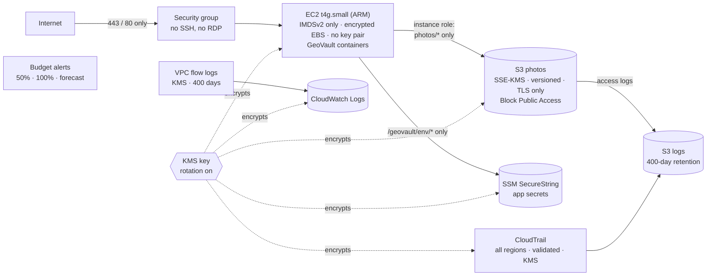

# geovault-infra

Infrastructure as code for [GeoVault](https://github.com/dragonday3/geovault), a security
portfolio app. This is **Project 2: cloud security**: a hardened, low-cost AWS deployment in
**ap-south-1 (Mumbai)**, written in Terraform and checked automatically.

> **Status: milestones C1–C3, local only.** The whole stack, the CI bootstrap (state bucket,
> GitHub OIDC roles) and a misconfiguration exercise run on a local AWS emulator and are
> verified on every push. **Nothing has been deployed to a real AWS account.** A real
> deployment happens only after a reviewed cost estimate and explicit approval.

## What it builds



| Module | Security decisions |
|---|---|
| `kms` | One customer-managed key with automatic rotation. Its policy admits only the account, CloudTrail (for its own trails) and CloudWatch Logs (for this region's log groups). |
| `network` | One VPC and one public subnet with **no NAT gateway** (saves about US$45/month). Ingress is only TCP 80/443, and egress only 443, 80 and NTP. The default security group is emptied. VPC flow logs capture all traffic. Rules are inline, so Terraform **deletes any rule added by hand**. |
| `storage` | Photos bucket: SSE-KMS, versioning, all four Block Public Access settings, ACLs disabled, a TLS-only bucket policy, and old versions expiring after 7 days (privacy erasure). Logs bucket: SSE-S3 (required for S3 access logs) and 400-day retention. |
| `iam` | Instance role limited to `photos/*` objects, its own SSM parameter path, and KMS use *via S3/SSM only*. No wildcard actions. Session Manager replaces SSH. |
| `secrets` | DB, JWT and GeoServer secrets are generated by Terraform and stored as SSM SecureString parameters. They are never typed or committed. |
| `compute` | `t4g.small` (Graviton). IMDSv2 is required with hop limit 1, which blocks SSRF credential theft and container access to IMDS. Encrypted gp3 root volume, no key pair. |
| `audit` | Multi-region CloudTrail with log-file validation and KMS encryption. A monthly budget alerts at 50 %, 100 % and the forecast. |
| `bootstrap` | **Account-level S3 Block Public Access** (added after exercise C3). Terraform state bucket (versioned, encrypted, private, TLS only). The GitHub OIDC provider with two CI roles (below). Terraform owns each role's **complete** policy set, so anything attached by hand is removed on the next apply. |

Logs are kept for **400 days in ap-south-1**. CERT-In's April 2022 directions require at least
180 days of logs, kept within India.

## CI access to AWS: OIDC, no stored keys

GitHub Actions gets a short-lived AWS session by presenting a GitHub-signed token. No access
key exists anywhere. Each role's trust policy pins the token's audience to `sts.amazonaws.com`
and its subject to this repository, using `StringEquals`, so no wildcard can widen it:

| Role | Who may assume it (token `sub`) | Permissions |
|---|---|---|
| `geovault-ci-plan` | `repo:dragonday3/geovault-infra:ref:refs/heads/main` only. Pull requests never get AWS credentials; they run on the emulator. | `ReadOnlyAccess`; writes only `*.tflock` in the state bucket; `kms:Decrypt` only on the `geovault-prod` key **and only via SSM** (it cannot decrypt the photos) |
| `geovault-ci-apply` | `repo:dragonday3/geovault-infra:environment:production`, i.e. only a job in the `production` environment, which waits for a human reviewer | `PowerUserAccess` (no IAM). IAM only on `geovault-prod-*`, where every write that can raise a role's power (`CreateRole`, `PutRolePolicy`, `AttachRolePolicy`, `PutRolePermissionsBoundary`) **requires the permissions boundary**. `PassRole` only to EC2 and VPC flow logs. **Denied:** tampering with the state bucket (policy, versioning, lifecycle, object versions), `cloudtrail:StopLogging`, and any edit to its own roles, the boundary or the OIDC provider |

**Permissions boundary.** `geovault-prod-boundary` is the most any stack role can ever do:
S3 objects in `geovault-prod-*` buckets, KMS decrypt and data keys, SSM Session Manager and
parameter reads, and flow-log writes. No IAM, no STS. Without it, `CreateRole` plus
`PutRolePolicy` plus the `sts:AssumeRole` that PowerUserAccess allows would let the apply role
mint itself an administrator. A fresh-eyes review caught this before anything shipped.

**Deploying is two jobs.**
1. `plan-for-apply` (read-only role) writes the full plan to the run summary, with a hash of
   its resource changes.
2. `apply-aws` waits in the `production` environment until a reviewer who has read that plan
   approves it. It then re-plans with the apply role and **refuses to apply if the changes
   hash differs**.

The plan file is never uploaded, because it contains secret values and this repository is
public. Pushes cannot cancel a running apply (separate concurrency groups), and all state
access is serialized.

**Residual risks (accepted, documented):**
- The apply subject does not pin a branch. The `production` environment's "main only"
  deployment rule (a GitHub setting, below) is what stops a branch from deploying.
- The apply role can still rewrite a stack role's trust policy. Whoever then assumes that role
  gets at most the boundary's permissions, which the apply role already has itself.
- Whether `CreateFlowLogs` sends `iam:PassedToService = vpc-flow-logs.amazonaws.com` is
  confirmed on the first real apply in C4.

The `plan-aws`, `plan-for-apply` and `apply-aws` jobs stay skipped until these repository
settings exist. They are set in milestone C4, after the bootstrap is applied:

| Setting | Kind | Value |
|---|---|---|
| `AWS_ACCOUNT_ID` | variable | the 12-digit account id |
| `AWS_PLAN_ROLE_ARN`, `AWS_APPLY_ROLE_ARN` | variables | outputs of `envs/aws-bootstrap` |
| `ALERT_EMAIL` | secret | budget alert address |
| `production` | environment | required reviewer = the repository owner; deployment branches: `main` only (this is a guard, see residual risks) |

## Run it locally (free, no AWS account)

[MiniStack](https://github.com/ministackorg/ministack) (MIT) emulates the AWS APIs on
`127.0.0.1:4566`. LocalStack's free edition has needed an account and auth token since
version 2026.03. Everything runs in pinned containers, so only Docker is needed.

```powershell
docker compose up -d ministack                                    # the emulator
docker compose run --rm tf-init -chdir=envs/local init            # download providers (online)
docker compose run --rm terraform -chdir=envs/local apply         # build the stack (offline)
docker compose run --rm verify                                    # 68 security checks
docker compose run --rm terraform -chdir=envs/local destroy       # tear down
docker compose run --rm checkov                                   # static IaC scan
```

`verify` prints one line per control and exits non-zero if any fails:

```
PASS  S3 photos  all four Block Public Access settings on   {"BlockPublicAcls": true, ...}
PASS  Network    no SSH/RDP/all-ports ingress                0 found
PASS  Compute    IMDSv2 required (http_tokens=required)      required
...
68/68 checks passed
```

### Why the local run cannot touch real AWS

There are three independent guards:

1. **No route out.** `terraform` and `verify` run on an `internal` Docker network that only
   reaches the emulator. Only `tf-init` has internet, and it can only run `terraform init`.
   This guard was added after a missing `s3control` endpoint sent one `ListTagsForResource`
   call to real AWS during development. That call carried the dummy credentials and was
   rejected with a 403.
2. **Dummy credentials.** The access key and secret are both `test`.
3. **Account pin.** `allowed_account_ids = ["000000000000"]` is checked against STS, and no
   real AWS account has that ID.

## Exercise C3: a public bucket, detected, fixed, prevented

A "partner export" bucket made public by mistake. It runs on the emulator in a sandbox account,
with synthetic data. Full write-up: [docs/exercises/c3-public-bucket.md](docs/exercises/c3-public-bucket.md).

| Phase | Result |
|---|---|
| Static scan of the resolved plan | Checkov flags the `Principal: *` policy and Block Public Access being off. The fixed plan has no exposure findings. |
| Vulnerable, deployed | Account scanner: **2 critical**, including an anonymous download of the CSV (HTTP 200) |
| Fixed + account guardrail | Anonymous download **403**, 0 findings |
| Same mistake again | **Rejected by S3** (`BlockPublicPolicy`), and the data stays private |

Lessons that changed the code:
- Scan the plan, not only the source. Source scanning missed the public policy.
- Values unknown at plan time are invisible to plan scanners.
- The stack lacked account-level Block Public Access. It is now in the bootstrap.

```powershell
docker compose run --rm tf-init -chdir=exercises/public-bucket init
sh terraform/exercises/public-bucket/run.sh       # asserts every phase; evidence in reports/
docker compose run --rm scan                      # account-wide S3 exposure scan (any account)
```

## Evidence that the checks work

The checks were mutation-tested. I broke controls by hand in the emulator, outside Terraform,
and confirmed the verifier catches each one, then that `terraform apply` repairs it:

| Mutation | Verifier | `terraform apply` |
|---|---|---|
| Deleted the photos bucket's Block Public Access | FAIL | re-created |
| Disabled KMS key rotation | FAIL | re-enabled |
| Added SSH 0.0.0.0/0 to the web security group | FAIL ×2 | **removed**, after switching to inline rules. With separate rule resources, the rogue rule survived `apply`. |
| Widened the apply role's trust to `repo:dragonday3/*` (StringLike) | FAIL | restored |
| Attached `AdministratorAccess` to the plan role | FAIL | **removed**, after switching to exclusive policy ownership. With a plain `policy_attachment`, it survived `apply`. |
| Added an inline `Action: *` policy to the instance role | FAIL, once the verifier checked the full inline list (the first version missed it) | removed |
| Removed the permissions boundary from the instance role | FAIL | re-attached |
| Added an unguarded `iam:CreateRole` to the apply role | FAIL | removed |
| Allowed IMDSv1 | n/a | the emulator does not implement `ModifyInstanceMetadataOptions` |

## What the emulator does not prove

The local run proves the configuration Terraform produces. It does **not** prove that AWS
enforces it. The following are left to the real-account audit (Prowler, AWS Config) in a later
milestone:

- **Policy enforcement:** bucket policies, IAM conditions and KMS conditions are stored, not evaluated.
- **Instance boot:** the instance is a metadata record. No OS boots, and the app is not deployed yet.
- **GuardDuty and AWS Config:** not exercised. MiniStack has no GuardDuty, and Config is planned for the audit window.
- **Known emulator drift:** MiniStack sometimes drops `tags_all` on CloudTrail and flow logs,
  so a second `plan` can show two cosmetic tag updates.
- **OIDC sign-in itself:** the trust policies are checked as documents. A real GitHub token
  exchange is first exercised in C4.

## Layout

```
compose.yml                  emulator + pinned Terraform, Checkov and verifier containers
terraform/modules/           kms, network, storage, iam, secrets, compute, audit
terraform/stack/             composes the modules (shared by both environments)
terraform/envs/local/        MiniStack: endpoints, dummy credentials, account pin
terraform/envs/aws/          ap-south-1, S3 backend with native locking. NOT applied.
terraform/envs/aws-bootstrap/ one-time: state bucket + OIDC + CI roles. NOT applied.
terraform/exercises/         C3 public-bucket exercise (emulator sandbox only)
verify/                      read-only baseline checks and the account S3 exposure scanner (boto3)
docs/exercises/              exercise write-ups with captured evidence
.github/workflows/ci.yml     fmt, validate, Checkov, Gitleaks, then emulator apply/verify/destroy
```

## Roadmap

| Milestone | Scope | Cost |
|---|---|---|
| C1 ✓ | Modules, local emulator, verifier, Checkov gate, CI | free |
| **C2** ✓ | GitHub OIDC roles for plan and apply (no stored keys), CI plan/apply jobs (inert until C4), state bucket bootstrap | free |
| **C3** ✓ | Misconfiguration exercise on the emulator: a deliberately public bucket, detected (plan scan, account scanner, anonymous read), fixed, then prevented by the account guardrail | free |
| C4 | Real deployment in ap-south-1 for a short audit window: cost estimate first, then Prowler before and after, and `terraform destroy` | billable, needs approval |
